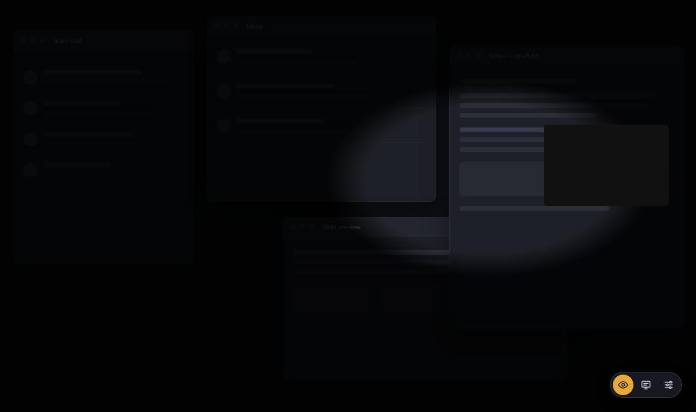
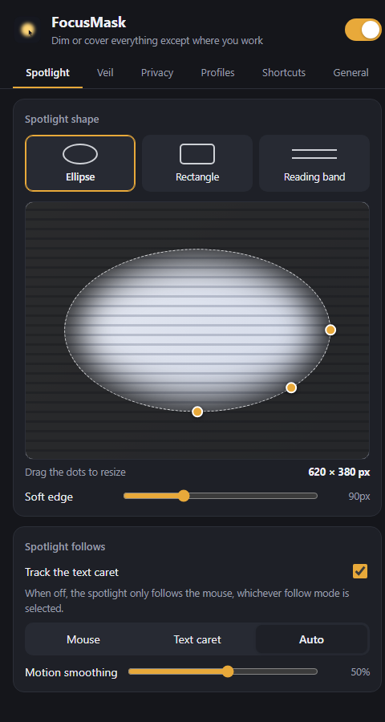
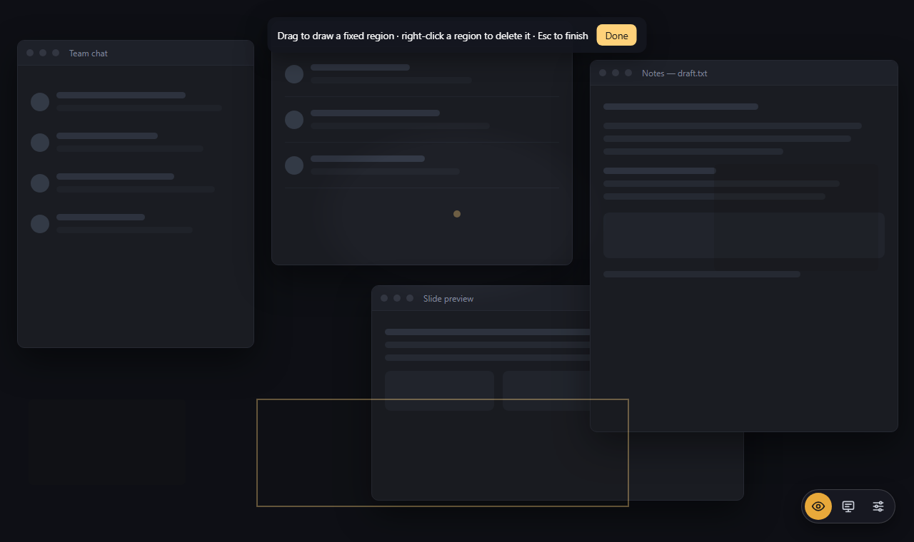
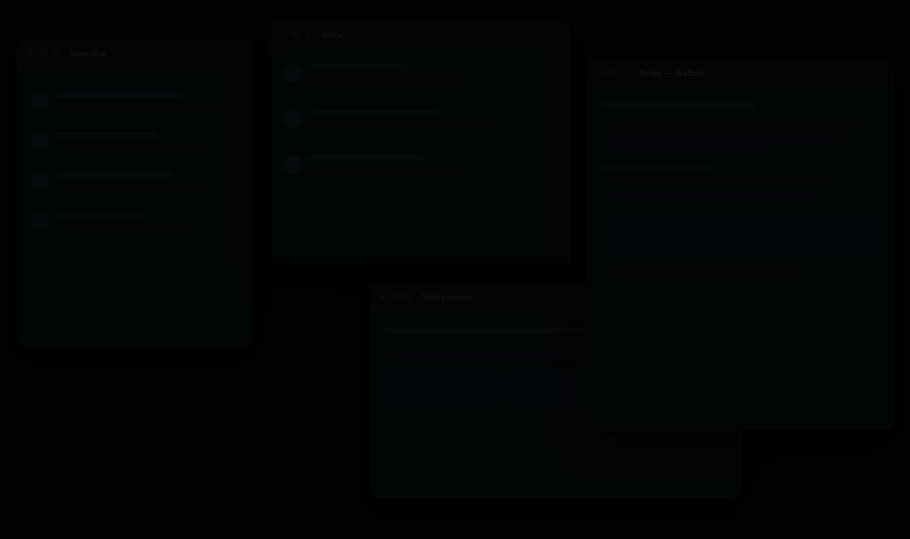
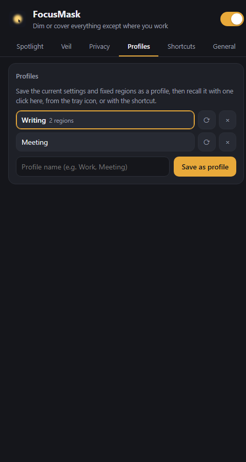
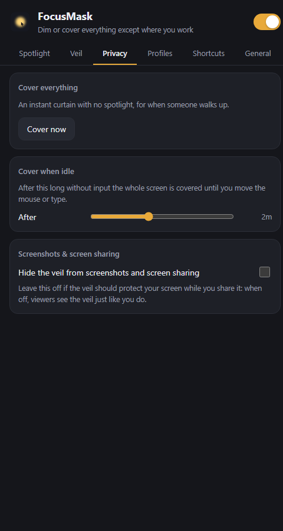

# FocusMask

**FocusMask** dims or blurs the whole screen except the small spot where you are working, so what is around it stays out of sight. Read, write or present without the rest of the screen competing for your eyes, and keep chats, email or a shared screen out of view.

[**Download the latest release**](https://github.com/aeghub/focusmask-releases/releases/latest) ·
Windows 10/11 and macOS 11+ (Apple silicon and Intel). Linux builds are experimental.

> The images below are illustrations of the app's screens and of the mask in action, drawn with made-up content: no real desktop, files or accounts are shown.

## The idea in one picture

The veil covers the desktop; the spotlight follows you. Everything outside it is dimmed:

Three things make it useful:

- **The veil** is a dim (or blurred) layer over everything. You choose the color and strength.
- **The spotlight** is a hole in the veil. It follows the mouse, the text caret, or both.
- **Fixed regions** are areas you draw once that stay covered all the time, spot or no spot.

## Turn it on and off

| Key | Does |
| --- | --- |
| `Alt+Shift+F` | Mask on / off |
| `Alt+Shift+C` | Cover everything now |
| `Alt+Shift+P` | Next saved profile |
| `Alt+Shift+W` | Show / hide the floating button |
| `Alt+Shift+=` / `Alt+Shift+-` | Bigger / smaller spotlight |
| `Alt+Shift+M` | Cycle what the spot follows (mouse, caret, auto) |
| `Alt+Shift+R` | Draw fixed regions |

On macOS, Alt is ⌥ Option. Every shortcut can be changed in **Settings → Shortcuts**.

## What it looks like

### Spotlight and shape

The spotlight is an ellipse, a rectangle or a full-width reading band, and it has a soft edge (all adjustable) so it feels like light rather than a hole:

### Focus on what you type (optional)

With **Auto**, the spot sits on your text caret while you type and jumps back to the mouse as soon as the mouse moves. **Text caret** follows the caret only. Caret tracking can be turned off completely with one switch: then the spotlight follows the mouse whatever the mode says.

- Windows: the Win32 caret, MSAA, then UI Automation, which covers browsers, Electron apps, Office and modern apps.
- macOS: the Accessibility API. The first time, macOS asks for the Accessibility permission.

### Fixed regions: privacy that does not move

Draw a box over a chat, a mail folder or anything private. It stays covered even when the spotlight is on top of it:

### Cover everything: an instant curtain

Someone walks up? `Alt+Shift+C` covers the whole screen, every display, with no hole. Press it again to go back. There is also **Cover when idle**: after a number of seconds without input the screen is covered until you move the mouse or press a key.

### Profiles

Save the current look and fixed regions under a name ("Writing", "Meeting", "Slides"), then recall it from the settings, from the tray menu, or with `Alt+Shift+P`. The name flashes on screen so you know what you got.

### Privacy screen sharing

- **Hide the veil from screenshots and screen sharing**: the mask you see is not in what other people receive. Leave it off when the mask itself is what should protect a shared screen.
- The mask can be kept out of your screen recordings for every sensitivity level, see **Settings → Privacy**.

### Floating button

An optional small on/off pill that stays above every window: toggle the mask, cover everything, or open the settings. Drag it anywhere; its size and opacity are adjustable.

## How to install

| System | File | Notes |
| --- | --- | --- |
| Windows 10/11, installer | `FocusMask-<version>-windows-x64-setup.exe` | Installs per user; SmartScreen may warn the first time → *More info → Run anyway*. |
| Windows 10/11, portable | `FocusMask-<version>-windows-x64-portable.zip` | Unzip anywhere and run `FocusMask.exe`. Your settings stay in that folder. |
| macOS 11+, Apple silicon and Intel | `FocusMask-<version>-macos-universal.dmg` | Not notarized by Apple: after copying to Applications, right-click → *Open* the first time. |
| Linux (experimental) | `.AppImage` or `.deb` | X11 only, no blur and no caret tracking. Untested. |

Windows needs the Microsoft Edge WebView2 runtime, which is built into Windows 11.

Installed copies check for new versions and update themselves from **Settings → General → Updates**. The portable copy tells you when a new version is out and opens this page.

## More

- **Language**: English by default, Arabic in **Settings → General**.
- **Launch at login** and the state the mask should start in.
- **Updates**: the app updates itself, no manual downloads after the first install.

Everything is described in the [release notes](https://github.com/aeghub/focusmask-releases/releases/latest) of the newest version.
